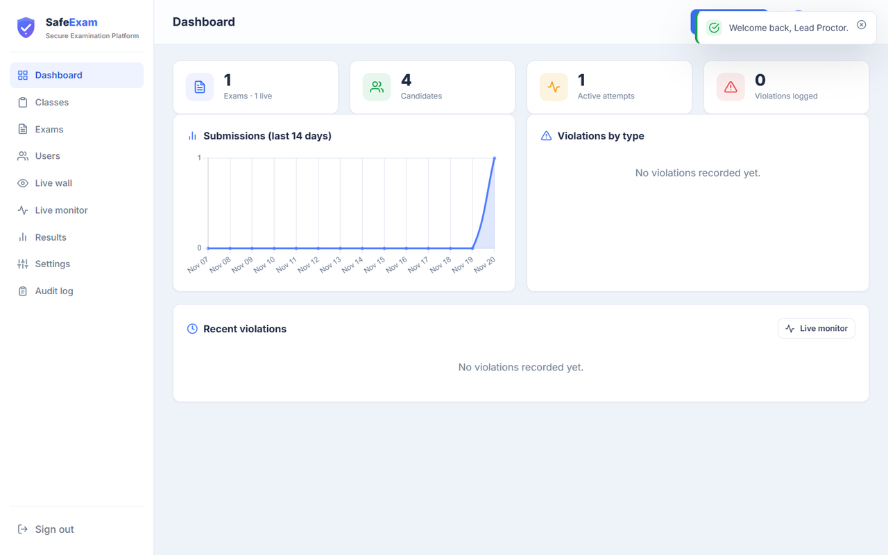
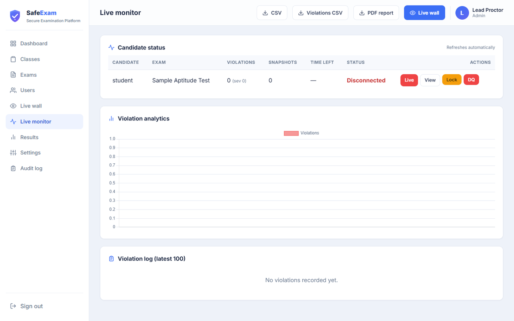
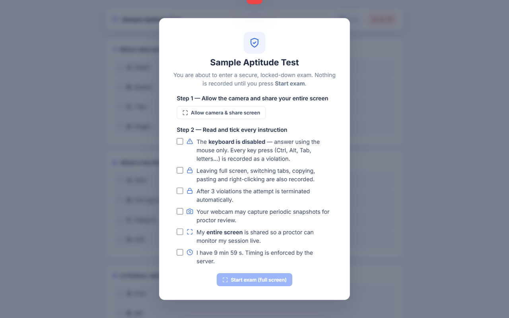
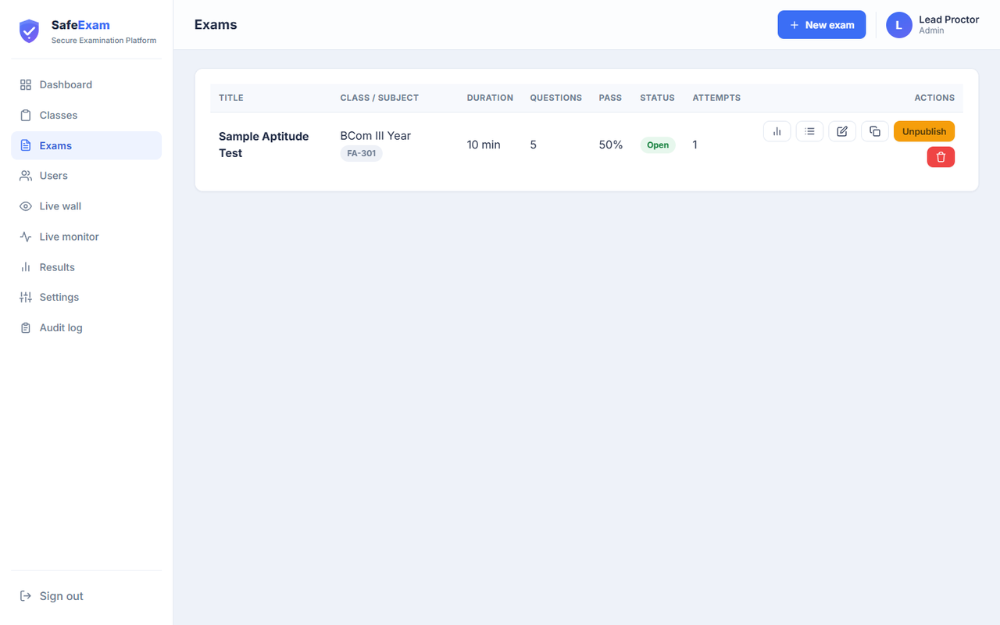
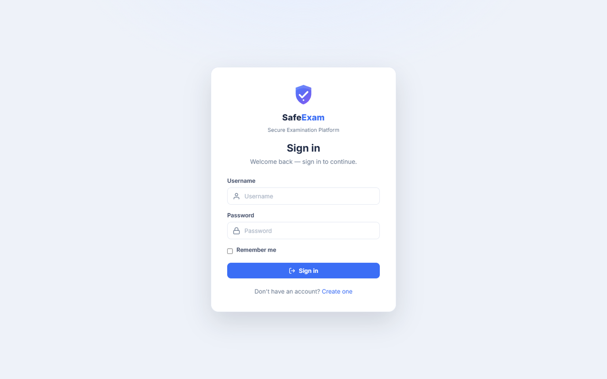

# SafeExam

**A proctored online exam platform built on the assumption that people will try to cheat.** The clock and the rules run on the server, and proctors can watch every candidate's screen and webcam live.

[Live site](https://exam.niranjand.in/) · [Case study](https://www.niranjand.in/projects/safeexam) · [Deployment guide](DEPLOY.md)



---

## What it is

Online exams are easy to game: switch to another tab, refresh the page to reset the timer, or tamper with the browser so warnings never fire. SafeExam is a web app for schools and colleges that runs multiple-choice exams in a locked-down, full-screen page and treats every one of those tricks as something to detect. The time left, the violation limit and the decision to lock someone out are all made by the server, not the browser. Teachers write exams, students take them, and proctors watch the live screens and review the evidence afterwards.

## Features

**For students**
- A clear dashboard of open, scheduled and completed exams.
- A secure-mode gate before the exam: share the whole screen, allow the camera, and read and tick each rule.
- Answers save automatically, a live countdown shows the time left, and reopening the exam resumes the same attempt.

**During the exam**
- Full-screen enforcement; leaving full screen, switching tabs and losing window focus are all recorded.
- Copy, cut, paste, right-click, text selection and risky shortcuts (Ctrl+C/V/X/S/P, F12, Ctrl+Shift+I/J/C, Ctrl+U) are blocked and logged.
- Heuristic developer-tools detection, second-monitor detection and an idle check (a focus loss straight after a long idle spell counts as more serious).
- Local face checks on the webcam (no face, more than one face) that run entirely in the browser.
- The candidate's screen and webcam stream to the proctor in near real time.

**For proctors and admins**
- **Live monitor**: every candidate's status, violations, time left and snapshots, with one-click lock, unlock, disqualify, extra time and re-entry.
- **Live wall**: every in-progress candidate's screen in one grid with a webcam inset, riskiest first. It is purely passive, so the candidate is never interrupted.
- **Flag a moment**: copies the current frame into a permanent evidence snapshot.
- **Replay**: reconstructs a finished attempt on a scrubbable timeline.
- **Results and statistics**: average score, pass rate, score distribution, per-question item analysis, manual score override, CSV and PDF evidence reports.
- Exam authoring with availability windows, per-exam violation limits, pass marks, strictness presets, option shuffling and CSV question import.
- User and class management, bulk student import with one-time credential sheets, global proctoring settings and an audit log of every staff action.

**For teachers**
- Their own portal for classes, exams, questions and results.
- They only ever see their own work, and they cannot watch live screens, manage users, change settings or read the audit log.

## Screenshots

| | |
|---|---|
|  |  |
| **Live monitor** — candidate status, violations and one-click actions | **Secure-mode gate** — screen share, camera and rules before the exam opens |
|  |  |
| **Exams** — publish, duplicate, statistics, review | **Sign in** |

## How it works

### Architecture

```
  Candidate browser                         Flask app (application factory + blueprints)
  ─────────────────                         ────────────────────────────────────────────
  security.js   lock-down, violation  ──▶  api/        state · answer · heartbeat · violation
  facecheck.js  local face checks             │          snapshot · live frame
  monitoring.js screen + webcam frames ──▶     ▼
  timer.js      countdown from server     proctoring.py  severity weights, risk window,
                                                          lock / disqualify decisions
                                          services.py    attempt lifecycle, grading
                                          framestore.py  live frames + snapshots (disk or DB)
                                          livehub.py     in-memory fan-out to watching proctors
  Proctor browser                              │
  ───────────────                              ▼
  live_monitor.js  ◀── WebSocket (ws.py) or HTTP polling ──  SQLAlchemy ─▶ SQLite / Turso (libSQL)
                                                                         / any SQLAlchemy URL
```

Blueprints split the app by role: `auth`, `student`, `teacher`, `admin`, the JSON `api` used by the exam page and the monitor, and `ws` for live frames.

### Notable engineering decisions

**The server owns the clock.** An attempt's deadline is its server-recorded start time plus the exam length. Reopening the exam resumes the same attempt rather than starting a new one, so a refresh, a closed tab or a changed system clock cannot buy extra time. Every heartbeat from the exam page checks the deadline and grades the attempt as "Time expired" once it passes.

**Cheating signals are weighed, not just counted.** Each violation type has a weight in `proctoring.py`: a stray key press or window blur costs 1, a tab switch or leaving full screen 2, suspected developer tools, a second monitor or multiple faces 3. The server adds them up against the exam's limit and locks and disqualifies the attempt itself, so a modified browser cannot ignore the result. A burst of violations inside a short window marks the candidate as High Risk on the monitor. Strictness presets (relaxed, standard, strict) apply per-type multipliers on top, and a proctor-approved re-entry starts the candidate on a fresh allowance while the reports keep the full history.

**Flagged moments become evidence.** Live frames are overwritten by each new upload and deleted when the attempt is graded. When a proctor flags a moment, the current webcam frame (or the screen frame if the exam has no camera) is copied into a permanent snapshot, so it still appears in the PDF evidence report later.

**Live view is pushed, with a fallback.** On a host that keeps a process running, frames arrive over a WebSocket and `livehub.py` hands each one to every watching proctor the moment it arrives, instead of stacking a capture interval on top of a polling interval. On serverless hosting the WebSocket routes are simply not registered and both sides fall back to HTTP polling. The hub is per-process state, so the Render config runs exactly one threaded gunicorn worker; scaling past one worker means moving the hub to Redis pub/sub, and `publish()` is the single place that would change.

**Built to run on serverless hosting.** On Vercel the disk is read-only and the request that receives a frame may not be the one that serves it, so frames and snapshots are stored in a Turso (libSQL) database instead of on disk. The `libsql` driver lacks parts of the DB-API that SQLAlchemy's SQLite dialect calls on every connect, so `turso.py` adds a small dialect that fills those gaps.

**Screen sharing is whole-screen or nothing.** Browsers always show their own picker before a page can capture the screen; no web page can skip it. SafeExam defaults the picker to the whole monitor, hides the exam tab from the list, disables switching mid-session, and rejects a single tab or window and asks again. The attempt does not open until a whole screen is shared. [DEPLOY.md](DEPLOY.md) covers removing the prompt on institution-managed machines.

**Teachers only see their own work.** Every teacher route loads exams, questions and classes through ownership checks that return "not found" for anything another teacher created.

### Security and privacy model

- Passwords are hashed (Werkzeug); sessions use Flask-Login; every form has CSRF protection (Flask-WTF).
- Face detection runs in the browser using the native `FaceDetector` where available, otherwise the MediaPipe face detector; webcam frames are not sent anywhere for analysis. If no detector is available it stays silent, because a missing detector is never a violation.
- Bulk-imported student credentials are held in memory only, never written to the database, and handed out exactly once through a one-time link that expires after 15 minutes.
- An optional Host allowlist (`SEB_ALLOWED_HOSTS`) and secure cookies for HTTPS deployments.
- Every proctor and admin action (lock, extra time, re-entry, score override and so on) is written to the audit log.

**Scope, stated plainly:** this is a web-based lock-down. It raises the cost of cheating and records a strong audit trail, but someone in full control of their own computer can still get around browser restrictions. Treat violations as signals for a proctor to review, not as proof, and pair it with a kiosk or native lock-down client for high-stakes exams.

## Tech stack

| Area | Choice |
|---|---|
| Backend | Python, Flask 3, Flask-SQLAlchemy, Flask-Login, Flask-WTF / WTForms |
| Database | SQLite locally, Turso (libSQL) in production, or any SQLAlchemy URL (e.g. PostgreSQL) |
| Live proctoring | flask-sock WebSockets with an HTTP polling fallback; in-memory fan-out hub |
| Frontend | Jinja2 templates, vanilla JavaScript, CSS with an inline SVG icon set |
| In-browser vision | native `FaceDetector` or MediaPipe Tasks Vision |
| Reports | ReportLab (PDF), CSV |
| Deployment | Vercel (serverless, polling), Render or any server with gunicorn (WebSockets) |
| Tests | pytest |

## Getting started

### Windows, one click

Double-click **`run.bat`**. On the first run it creates a virtual environment, installs the requirements, copies `.env.example` to `.env` and seeds the demo accounts; later runs just start the server and open the browser at `http://127.0.0.1:5001/`.

### Any platform

```bash
python -m venv venv
venv\Scripts\activate            # Windows
# source venv/bin/activate       # macOS / Linux

pip install -r requirements.txt
cp .env.example .env             # optional; edit SEB_SECRET_KEY etc.
python seed.py                   # demo accounts + a sample exam
python app.py
```

Open **http://127.0.0.1:5001/**. Override with `SEB_PORT` / `SEB_HOST`.

`seed.py` creates local demo accounts for each role (admin, teacher and student; the usernames and passwords are printed when it runs), a sample class and a published 5-question "Sample Aptitude Test". Sign in as the student to take it, then as the admin to watch the live monitor and export a report. **Change these credentials before exposing the app to anyone.**

Camera and screen capture only work in a secure context: HTTPS in production, or `http://localhost` / `127.0.0.1` during development.

### Configuration

All settings are environment variables (see `.env.example`):

| Variable | Default | Purpose |
|---|---|---|
| `SEB_SECRET_KEY` | dev key | **Set a long random value in production.** |
| `SEB_ENV` | `development` | `development` · `production` · `testing` |
| `SEB_DATABASE_URI` | local SQLite | Any SQLAlchemy URL |
| `SEB_TURSO_URL` / `SEB_TURSO_TOKEN` | – | Turso / libSQL database; takes priority when both are set |
| `SEB_FRAME_STORAGE` | `db` with Turso, else `disk` | Where live frames and snapshots are kept; must be `db` on serverless hosts |
| `SEB_ALLOWED_HOSTS` | empty (allow all) | Comma-separated Host allowlist |
| `SEB_INIT_DB` | `1` | Create tables on startup; set `0` in serverless production |
| `SEB_SECURE_COOKIES` | `0` | Set `1` when served over HTTPS |
| `SEB_MAX_VIOLATIONS` | `3` | Cumulative severity that terminates an attempt |
| `SEB_RISK_WINDOW_SECONDS` / `SEB_RISK_WINDOW_THRESHOLD` | `30` / `2` | High-risk burst detection |
| `SEB_SNAPSHOT_INTERVAL` | `20` | Seconds between webcam snapshots (`0` disables) |
| `SEB_HEARTBEAT_TIMEOUT` | – | Heartbeat silence before a candidate counts as disconnected |
| `SEB_HOST` / `SEB_PORT` | `127.0.0.1` / `5001` | Dev server bind address |

The proctoring values can also be changed at runtime from the admin **Settings** page.

### Tests

```bash
pip install pytest
pytest
```

51 tests across 5 files cover login and registration, role-based access, a full exam scored end to end, disqualification at the violation limit, auto-completion of an expired attempt, PDF evidence reports, CSV exports, class enrolment and bulk import, proctor operations, violation signals and question handling, and teacher ownership of their own students and exams.

### Deploying

- **A normal server (recommended for real exams):** `gunicorn wsgi:app -w 1 -k gthread --threads 24 --timeout 300` behind HTTPS. `render.yaml` is a ready-made Render blueprint and explains each flag: one worker because the live hub is in memory, threaded because each open WebSocket holds a thread, and a long timeout so idle sockets are not killed mid-exam.
- **Vercel + Turso:** `api/index.py` and `vercel.json`; create the schema once with `scripts/init_db.py`. Live view uses polling there.
- `GET /healthz` reports which database the app is actually talking to.

Full steps are in **[DEPLOY.md](DEPLOY.md)**.

## Project structure

```
app.py                  dev entry point (python app.py)
wsgi.py                 production entry point (gunicorn wsgi:app)
config.py               environment-driven configuration
seed.py                 demo accounts, class and sample exam
run.bat                 one-click Windows launcher
render.yaml             Render blueprint (WebSockets)
vercel.json, api/       Vercel serverless entry point
scripts/init_db.py      create the schema + seed against Turso
safeexam/
  __init__.py           application factory, /healthz
  models.py             User, SchoolClass, Exam, Question, Submission, Answer,
                        Violation, ProctorSnapshot, LiveFrame, AppSetting, AuditLog
  proctoring.py         violation weights, strictness presets, risk and termination rules
  services.py           attempt lifecycle, grading, extra time, re-entry
  framestore.py         live frames + snapshots on disk or in the database
  livehub.py            in-memory fan-out of live frames to proctors
  turso.py              libSQL dialect for SQLAlchemy
  enrolment.py          classes, bulk import, one-time credential sheets
  reports.py            PDF evidence reports
  audit.py              staff action log
  blueprints/           auth · student · teacher · admin · api · ws
static/js/              security, facecheck, monitoring, timer, exam, live_monitor
templates/              Jinja2: auth, student, teacher, admin, shared, errors
tests/                  pytest suite
```

## Author

Built by Niranjan D — [niranjand.in](https://www.niranjand.in) · [GitHub](https://github.com/Niranjan266) · [LinkedIn](https://www.linkedin.com/in/niranjan266)
